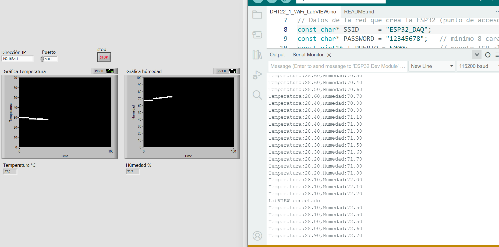
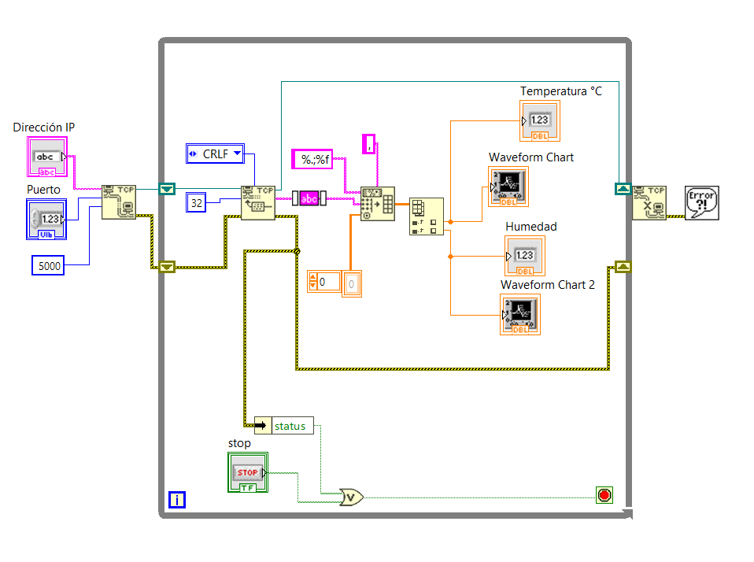

# DHT22_1_WiFi_LabVIEW

Medición de temperatura y humedad relativa con un sensor DHT22 y una ESP32. Los datos se envían a LabVIEW por WiFi, con la ESP32 funcionando como punto de acceso.

**Qué cambia respecto a `DS18B20_2_WiFi_LabVIEW`:** se envían **dos variables en una misma trama** (formato tipo CSV) y LabVIEW las separa y grafica cada una. La comunicación (WiFi + TCP) y la estructura del VI son las mismas. Además, el firmware detecta lecturas fallidas y no las envía.

<!-- Agregar capturas cuando el VI esté terminado:

-->

## Archivos
| Archivo | Descripción |
|---|---|
| `DHT22_1_WiFi_LabVIEW.ino` | Programa de la ESP32 (Arduino IDE) |
| `MonitorHumedadTemperatura.vi` | Cliente TCP en LabVIEW que muestra y grafica temperatura y humedad |
| `Interfaz.png` / `DiagramaBloques.png` | Capturas del panel frontal y del diagrama de bloques |

## Material
- ESP32
- Sensor DHT22 (AM2302), suelto o en módulo
- Resistencia de 10 kΩ (pull-up entre DATA y 3.3 V). Muchos módulos ya la incluyen.
- PC con WiFi y LabVIEW 2025 o posterior (el `.vi` no abre en versiones anteriores)

## El sensor DHT22
- Rango: −40 a 80 °C (±0.5 °C) y 0 a 100 % HR (±2 a 5 %).
- Usa un protocolo propio de un solo hilo (no es 1-Wire como el DS18B20): la ESP32 manda un pulso de inicio y el sensor responde con 40 bits (humedad, temperatura y suma de verificación).
- Cada medición tarda y el sensor necesita **al menos 2 s entre lecturas**. Si se lee más rápido, devuelve el valor anterior o falla.

## Conexiones
| DHT22 (sensor suelto, de izquierda a derecha con la rejilla al frente) | ESP32 |
|---|---|
| 1 VCC | 3.3 V |
| 2 DATA | GPIO 4 (+ 10 kΩ a 3.3 V) |
| 3 NC | sin conectar |
| 4 GND | GND |

En un módulo de 3 pines (`+`, `out`, `-`) se conecta igual: `+` a 3.3 V, `out` a GPIO 4 y `-` a GND.

Librería de Arduino: **DHT sensor library** de Adafruit (el gestor de librerías ofrece instalar también **Adafruit Unified Sensor**, que es necesaria). `WiFi.h` viene incluida en el paquete de la ESP32.

## Comunicación
- Red WiFi: `ESP32_DAQ` / contraseña `12345678`
- ESP32 = servidor TCP en `192.168.4.1:5000`
- LabVIEW = cliente TCP
- Formato: una línea cada 2 s con `temperatura,humedad` en texto, terminada en CR+LF. Ejemplo: `24.56,55.30\r\n`
- Si el sensor no responde, la ESP32 **no envía** la línea y escribe `Error: el DHT22 no responde` en el monitor serie.

Se envían ambos valores en la misma línea, y no en dos mensajes, para que LabVIEW siempre reciba la pareja completa y no pueda confundir cuál es la temperatura y cuál la humedad.

## VI en LabVIEW

Se parte de `MonitorTemperaturaDS18B20.vi` del proyecto anterior (*File » Save As » Copy* con el nombre `MonitorHumedadTemperatura.vi`). La conexión TCP no cambia; solo se reemplaza la conversión del texto a número.

**Panel frontal:** controles `Dirección IP` y `Puerto`, indicadores `Temperatura °C` y `Humedad %`, dos Waveform Charts (uno por variable, porque sus escalas son distintas) y botón `STOP`.

**Diagrama de bloques:**
1. `TCP Open Connection`: address = `Dirección IP`, remote port = `Puerto`, timeout = `5000` ms (igual que antes).
2. `While Loop` con:
   - `TCP Read`: mode = **CRLF**, bytes to read = **32** (la línea mide unos 13 bytes; se deja margen).
   - `Trim Whitespace` (String): quita el `\r\n` del final.
   - `Spreadsheet String To Array` (String) en lugar de `Fract/Exp String To Number`:
     - `delimiter` = constante `,`
     - `format string` = `%.;%f`. El `%.;` obliga a usar el punto como separador decimal sin importar la configuración regional de Windows (cumple la misma función que el **False** en `use system decimal point` del proyecto anterior).
     - `array type` = constante de **arreglo 1D de DBL** (clic derecho en la terminal » Create » Constant y cambiarla a 1D). Si no se conecta, la salida es un arreglo 2D.
   - `Index Array` (Array) estirado a dos salidas: índice 0 = temperatura, índice 1 = humedad. Cada salida va a su indicador y a su Waveform Chart.
   - Condición de paro: `OR` entre el botón STOP y el `status` del error (Unbundle By Name).
   - El connection ID y el error pasan por shift registers.
3. Fuera del lazo: `TCP Close Connection` → `Simple Error Handler`.

No se necesita Wait dentro del lazo: `TCP Read` espera la línea completa, así que el ritmo (cada 2 s) lo marca la ESP32. El timeout por defecto de `TCP Read` es 25 s, de sobra para ese periodo.

> **Alternativa:** un solo Waveform Chart con las dos trazas. Se juntan los dos valores con `Bundle` antes de conectarlos al chart. Ocupa menos espacio, pero ambas variables comparten el eje Y.

## Uso
1. Instalar la librería, cargar el sketch en la ESP32 y abrir el monitor serie (115200 baudios). También se puede abrir el Serial Plotter para ver ambas curvas.
2. Conectar la PC a la red `ESP32_DAQ` (la PC no tendrá internet mientras esté conectada).
3. Abrir `MonitorHumedadTemperatura.vi`, verificar la IP `192.168.4.1` y el puerto `5000`, y ejecutarlo.
4. En el monitor serie debe aparecer `LabVIEW conectado`.

## Solución de problemas
| Síntoma | Causa / solución |
|---|---|
| Solo se muestra la temperatura | Se dejó `Fract/Exp String To Number`, que se detiene en la coma. Usar `Spreadsheet String To Array`. |
| Valores truncados (24 en vez de 24.56) | Falta el `%.;` en el format string y Windows usa coma decimal. Usar `%.;%f`. |
| Error de tipo al conectar `Index Array` | `array type` sin conectar: la salida es 2D. Conectar una constante de arreglo 1D de DBL. |
| `Error: el DHT22 no responde` en el monitor serie | Revisar cableado y resistencia de 10 kΩ, y que `TIPO_SENSOR` sea `DHT22` (no `DHT11`). |
| Error 56 (timeout) | `TCP Read` no está en modo CRLF, o el sensor falla y la ESP32 no envía datos. |
| Error 63 (conexión rechazada) | IP o puerto incorrectos, o la ESP32 apagada. |
| Error 66 (conexión cerrada) | La ESP32 se reinició o se desconectó. |
| No aparece `LabVIEW conectado` | La PC no está en la red `ESP32_DAQ` (Windows puede cambiarse solo a otra red). |

Para probar la ESP32 sin LabVIEW: PuTTY en modo *Raw*, host `192.168.4.1`, puerto `5000`.

## Qué se aprende
- Leer un sensor con un protocolo digital propio y respetar su tiempo mínimo entre lecturas.
- Validar lecturas (`isnan`) antes de enviarlas.
- Diseñar una trama con varias variables y separarla en LabVIEW (`Spreadsheet String To Array` + `Index Array`).
