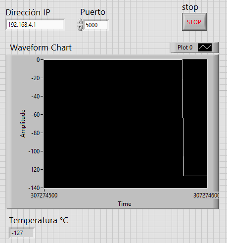
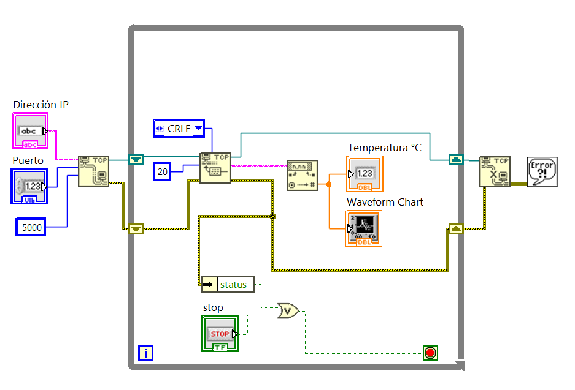

# DS18B20_2_WiFi_LabVIEW

Lectura de un sensor de temperatura DS18B20 con ESP32 y envío de los datos a LabVIEW por WiFi, con la ESP32 funcionando como punto de acceso.

**Qué cambia respecto a `DS18B20_1`:** se agrega comunicación inalámbrica (WiFi + TCP), una interfaz gráfica en LabVIEW y temporización con `millis()` en lugar de `delay()`.

## Archivos
| Archivo | Descripción |
|---|---|
| `DS18B20_2_WiFi_LabVIEW.ino` | Programa de la ESP32 (Arduino IDE) |
| `MonitorTemperatura.vi` | Cliente TCP en LabVIEW que muestra y grafica la temperatura |
| `Interfaz.png` / `DiagramaBloques.png` | Capturas del panel frontal y del diagrama de bloques |

## Material
- ESP32
- Sensor DS18B20
- Resistencia de 4.7 kΩ (pull-up entre DATA y 3.3 V)
- PC con WiFi y LabVIEW 2025 o posterior (el `.vi` no abre en versiones anteriores)

## Conexiones
| DS18B20 | ESP32 |
|---|---|
| VDD | 3.3 V |
| GND | GND |
| DATA | GPIO 4 (+ 4.7 kΩ a 3.3 V) |

Librerías de Arduino: `OneWire` y `DallasTemperature`. `WiFi.h` viene incluida en el paquete de la ESP32.

## Comunicación
- Red WiFi: `ESP32_DAQ` / contraseña `12345678`
- ESP32 = servidor TCP en `192.168.4.1:5000`
- LabVIEW = cliente TCP
- Formato: un valor por segundo en texto, terminado en CR+LF. Ejemplo: `24.56\r\n`
- `-127.00` indica que el sensor no responde (revisar cableado y resistencia pull-up).

## VI en LabVIEW

**Panel frontal:** controles `Dirección IP` y `Puerto`, indicador `Temperatura °C`, Waveform Chart y botón `STOP`.

**Diagrama de bloques** (paleta Data Communication » Protocols » TCP):
1. `TCP Open Connection`: address = `Dirección IP`, remote port = `Puerto`, timeout = `5000` ms.
2. `While Loop` con:
   - `TCP Read`: mode = **CRLF**, bytes to read = **20**.
   - `Fract/Exp String To Number` (String » Number/String Conversion): convierte el texto a número.
   - El número va al indicador y al Waveform Chart.
   - Condición de paro: `OR` entre el botón STOP y el `status` del error (Unbundle By Name).
   - El connection ID y el error pasan por shift registers.
3. Fuera del lazo: `TCP Close Connection` → `Simple Error Handler`.

No se necesita Wait dentro del lazo: `TCP Read` espera a recibir la línea completa, así que el ritmo lo marca la ESP32.

## Uso
1. Cargar el sketch en la ESP32 y abrir el monitor serie (115200 baudios).
2. Conectar la PC a la red `ESP32_DAQ` (la PC no tendrá internet mientras esté conectada).
3. Abrir `MonitorTemperatura.vi`, verificar la IP `192.168.4.1` y el puerto `5000`, y ejecutarlo.
4. En el monitor serie debe aparecer `LabVIEW conectado`.

## Solución de problemas
| Síntoma | Causa / solución |
|---|---|
| LabVIEW muestra 0 y no hay error | `bytes to read` de `TCP Read` sin conectar o en 0: lee al instante un texto vacío. Conectar una constante de 20. |
| Error 56 (timeout) | `TCP Read` no está en modo CRLF, o la ESP32 no envía datos. |
| Error 63 (conexión rechazada) | IP o puerto incorrectos, o la ESP32 apagada. |
| Error 66 (conexión cerrada) | La ESP32 se reinició o se desconectó. |
| No aparece `LabVIEW conectado` | La PC no está en la red `ESP32_DAQ` (Windows puede cambiarse solo a otra red). |
| Siempre llega `-127` | El sensor no responde: revisar conexiones y la resistencia de 4.7 kΩ. |

Para probar la ESP32 sin LabVIEW: PuTTY en modo *Raw*, host `192.168.4.1`, puerto `5000`.
