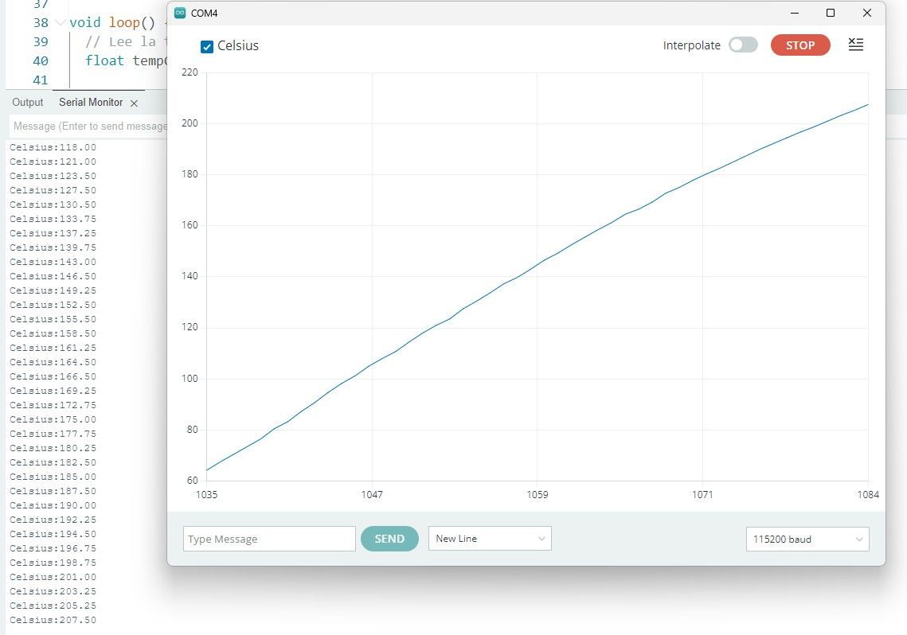
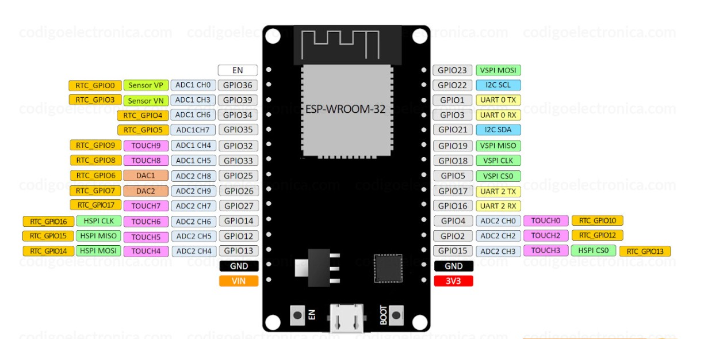

# Monitor de Temperatura con MAX6675 y ESP32

Proyecto en Arduino IDE para leer la temperatura de un **termopar tipo K** mediante el
módulo **MAX6675** conectado a una placa **ESP32**, y mostrarla en tiempo real en el
**Monitor Serial** y en el **Serial Plotter** del IDE de Arduino.



> En la imagen se observa el **Serial Plotter** graficando la temperatura en grados Celsius
> mientras el termopar se calienta (la curva sube de ~60 °C a ~207 °C), junto con el
> **Serial Monitor** mostrando cada lectura en formato `Celsius:valor`.

---

## ¿Qué hace este proyecto?

El programa toma muestras periódicas de temperatura desde el termopar y las envía por el
puerto serie a la computadora. Gracias al formato `Etiqueta:valor` que se usa en la salida,
los datos se pueden:

- **Leer numéricamente** en el Monitor Serial, o
- **Graficar en tiempo real** en el Serial Plotter del IDE de Arduino.

Si el termopar se desconecta, el programa lo detecta y avisa con un mensaje de error en
lugar de mostrar un valor incorrecto.

---

## ¿Cómo funciona el sensor MAX6675?

El **MAX6675** es un convertidor analógico-digital especializado en termopares **tipo K**.
Internamente:

1. **Amplifica** la pequeña tensión (del orden de microvoltios) que genera el termopar por
   el efecto Seebeck.
2. Realiza la **compensación de unión fría** (mide su propia temperatura para corregir la
   lectura).
3. **Linealiza y digitaliza** el resultado, entregando la temperatura con una resolución de
   **12 bits (0.25 °C por paso)** en un rango de **0 °C a 1024 °C**.

La comunicación con el ESP32 es por **SPI** (solo lectura): el ESP32 genera el reloj (SCK),
activa el chip (CS) y recibe los datos (SO/MISO). El módulo necesita **~220 ms entre
lecturas**, por lo que no se debe leer más rápido que eso.

---

## La placa ESP32

Se utiliza una placa **ESP32 (ESP-WROOM-32 DevKit)**. En su diagrama de pines se identifican
los pines empleados para este proyecto:



*Imagen: [codigoelectronica.com](https://codigoelectronica.com).*

Se eligieron los pines del **bus VSPI** del ESP32 para mantener el cableado ordenado y
compatible con el SPI por hardware. La librería de Adafruit genera las señales SPI **por
software** (con `digitalWrite`), así que en realidad el MAX6675 funcionaría en cualquier
GPIO digital; usar los pines VSPI facilita migrar después a la librería `SPI.h` por hardware.

| Pin del código | Etiqueta en la placa | Función SPI    |
|:--------------:|:--------------------:|----------------|
| `GPIO 18`      | `VSPI CLK`           | Reloj (SCK)    |
| `GPIO 5`       | `VSPI CS0`           | Chip Select    |
| `GPIO 19`      | `VSPI MISO`          | Datos (SO)     |
| `3V3`          | `3V3`                | Alimentación   |
| `GND`          | `GND`                | Tierra         |

---

## Conexiones MAX6675 → ESP32

| MAX6675 | Función                         | Pin ESP32 |
|:-------:|---------------------------------|:---------:|
| `VCC`   | Alimentación (3.3 V o 5 V)      | `3V3`     |
| `GND`   | Tierra                          | `GND`     |
| `SCK`   | Reloj SPI                       | `GPIO 18` |
| `CS`    | Chip Select (selección de chip) | `GPIO 5`  |
| `SO`    | Salida de datos (MISO)          | `GPIO 19` |

> El MAX6675 solo **envía** datos hacia el ESP32 (es un dispositivo SPI de solo lectura),
> por eso no se conecta una línea MOSI.

### Diagrama de conexión

```
   MAX6675                 ESP32
  ┌─────────┐           ┌──────────┐
  │  VCC ●──┼───────────┤ 3V3      │
  │  GND ●──┼───────────┤ GND      │
  │  SCK ●──┼───────────┤ GPIO 18  │
  │  CS  ●──┼───────────┤ GPIO 5   │
  │  SO  ●──┼───────────┤ GPIO 19  │
  └─────────┘           └──────────┘
       │
   [Termopar tipo K]
```

---

## ¿Cómo funciona el código?

El sketch se encuentra en [`MAX6675_1.ino`](MAX6675_1.ino).

### 1. Inclusión de la librería y definición de pines

```cpp
#include "max6675.h"

const int PIN_SCK = 18;   // Reloj
const int PIN_CS  = 5;    // Chip Select
const int PIN_SO  = 19;   // Salida de datos (MISO)

MAX6675 termopar(PIN_SCK, PIN_CS, PIN_SO);
```

Se incluye la librería **MAX6675** y se crea un objeto `termopar` indicándole en qué pines
del ESP32 está conectado el módulo.

### 2. Configuración inicial (`setup`)

```cpp
void setup() {
  Serial.begin(115200);
  Serial.println("Sensor de temperatura MAX6675");
  Serial.println("-----------------------------");
  delay(500);   // Espera a que el modulo se estabilice
}
```

Inicia la comunicación serie a **115200 baudios**, imprime un encabezado y espera medio
segundo a que el módulo se estabilice.

### 3. Lectura continua (`loop`)

```cpp
void loop() {
  float tempC = termopar.readCelsius();

  if (isnan(tempC)) {
    Serial.println("Error: termopar desconectado o sin lectura.");
  } else {
    Serial.print("Celsius:");
    Serial.println(tempC);
  }

  delay(250);   // ~4 muestras por segundo (minimo recomendado: 220 ms)
}
```

En cada ciclo:

1. **Lee** la temperatura en grados Celsius con `termopar.readCelsius()`.
2. **Valida** la lectura: si devuelve `NAN`, significa que el termopar está desconectado y
   se muestra un mensaje de error.
3. **Envía** el dato en el formato `Celsius:valor`, compatible con el Serial Plotter.
4. **Espera 250 ms** antes de la siguiente muestra (≈ 4 muestras por segundo), respetando el
   tiempo mínimo de 220 ms que requiere el MAX6675.

---

## Requisitos

- Placa **ESP32 (ESP-WROOM-32)** + módulo **MAX6675** con termopar tipo K.
- **Arduino IDE** con soporte para placas ESP32 instalado.
- Librería **"MAX6675 library" de Adafruit**
  (`Herramientas → Administrar Bibliotecas... → buscar "MAX6675"`).

## Uso

1. Realiza las conexiones según la tabla anterior.
2. Abre `MAX6675_1/MAX6675_1.ino` en el Arduino IDE.
3. Instala la librería MAX6675 si aún no la tienes.
4. Selecciona tu placa ESP32 y el puerto COM correspondiente.
5. Sube el programa a la placa.
6. Abre el **Monitor Serial** (115200 baudios) para ver los valores, o el
   **Serial Plotter** para verlos graficados como en la imagen.
