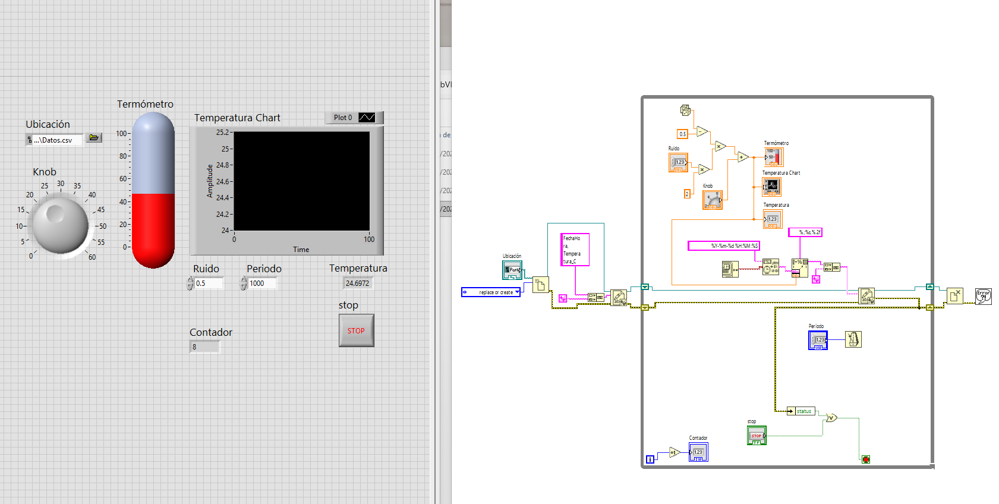

# Simulacion_1_CSV_LabVIEW

Simulación de un sensor de temperatura en LabVIEW con registro de datos (*data logging*) en un archivo CSV que se abre directamente en Excel. No usa ESP32 ni hardware.

**Qué cambia respecto a `DHT22_1_WiFi_LabVIEW`:** la idea nueva es el **almacenamiento**. Hasta ahora los datos solo se veían en pantalla y se perdían al detener el VI; aquí cada lectura se guarda con su fecha y hora. Para concentrarse en el manejo de archivos, el sensor se reemplaza por una simulación (valor base + ruido aleatorio). La misma estructura se puede agregar después a los VIs de los proyectos con WiFi.



## Archivos
| Archivo | Descripción |
|---|---|
| `SimuladorTemperaturaCSV.vi` | Simula la temperatura, la muestra, la grafica y la guarda en CSV |
| `Simulacion.png` | Captura del panel frontal (izquierda) y del diagrama de bloques (derecha) |
| `Datos.csv` | Archivo de ejemplo generado por el VI |

## Material
- PC con LabVIEW 2025 o posterior (el `.vi` no abre en versiones anteriores)
- Excel u otra hoja de cálculo para revisar el archivo (opcional)

## Formato del archivo
Texto plano, una línea por muestra, columnas separadas por coma y punto decimal. La primera línea es el encabezado:

```
FechaHora,Temperatura_C
2026-10-27 18:31:29,24.76
2026-10-27 18:31:30,24.61
2026-10-27 18:31:31,25.14
```

Se eligió CSV y no `.xlsx` porque es texto: lo abre cualquier programa (Excel, Python, MATLAB, el Bloc de notas), se escribe línea por línea sin reescribir el archivo y, si el programa se interrumpe, las líneas ya escritas no se pierden.

## Panel frontal

| Elemento | Tipo | Función |
|---|---|---|
| `Ubicación` | Control de ruta (File Path Control) | Ruta completa del `.csv` donde se guardan los datos |
| `Knob` | Control (perilla), 0 a 60 | Temperatura base: valor alrededor del cual varía la simulación |
| `Ruido` | Control numérico, `0.5` | Variación máxima hacia arriba o abajo de la temperatura base (°C) |
| `Periodo` | Control numérico (I32), `1000` | Tiempo entre muestras en milisegundos |
| `Termómetro` | Indicador (Thermometer) | Lectura actual de forma visual |
| `Temperatura` | Indicador numérico | Lectura actual con todos sus decimales |
| `Temperatura Chart` | Waveform Chart | Historial de las lecturas; cada punto es una muestra |
| `Contador` | Indicador numérico (I32) | Cuántas muestras se han guardado en el archivo |
| `stop` | Botón booleano | Termina el VI de forma ordenada y cierra el archivo |

En el control `Ubicación`: clic derecho » *Browse Options* » *Selection mode* = **New or existing**, para poder escribir el nombre de un archivo que aún no existe.

## Diagrama de bloques: cómo funciona

El diagrama tiene tres partes que se ejecutan en orden gracias a los cables de **refnum** (verde azulado) y de **error** (amarillo): ningún bloque se ejecuta hasta que le llegan sus entradas, así que el archivo siempre se abre antes de escribirse y se cierra al final.

```
[Abrir archivo] → [Escribir encabezado] → [While Loop: simular → mostrar → escribir línea] → [Cerrar archivo] → [Mostrar error]
```

### 1. Antes del lazo: abrir el archivo y escribir el encabezado

| Bloque | Qué hace |
|---|---|
| `Ubicación` | Entrega la ruta del archivo. |
| Constante `replace or create` | Indica qué hacer con el archivo: si no existe lo crea y si existe lo borra y empieza de cero. Así cada ejecución genera un archivo limpio. |
| `Open/Create/Replace File` | Abre el archivo y entrega una **refnum**, una "referencia" que los demás bloques usan para saber en qué archivo escribir. También entrega el cable de error. |
| Constante `FechaHora,Temperatura_C` | Texto del encabezado: los nombres de las dos columnas. |
| Constante `End of Line` (rosa, icono ↵) | Salto de línea. Sin él todas las muestras quedarían en una sola línea. |
| `Concatenate Strings` | Une el encabezado y el salto de línea en un solo texto. |
| `Write to Text File` | Escribe ese texto en el archivo. Su refnum y su error de salida entran al lazo. |

### 2. Dentro del `While Loop`: una muestra por iteración

**Simulación del sensor (parte superior):**

| Bloque | Qué hace |
|---|---|
| `Random Number (0-1)` (icono de dados) | Número aleatorio entre 0 y 1. |
| `Subtract` con `0.5` | Lo centra en cero: queda entre −0.5 y +0.5. |
| `Multiply` de `2` × `Ruido` | Calcula el ancho total de la variación (con `Ruido` = 0.5 da 1). |
| `Multiply` | Escala el aleatorio: queda entre −`Ruido` y +`Ruido`. |
| `Add` con `Knob` | Suma la temperatura base. Resultado: un valor entre base − ruido y base + ruido, como un sensor real con algo de ruido. |
| `Termómetro`, `Temperatura Chart`, `Temperatura` | Muestran la lectura. El chart guarda internamente los puntos anteriores, por eso dibuja el historial. |

**Armado de la línea del CSV (parte media):**

| Bloque | Qué hace |
|---|---|
| `Get Date/Time In Seconds` | Lee la hora actual de la PC (segundos desde 1904, formato interno de LabVIEW). |
| `Format Date/Time String` con `%Y-%m-%d %H:%M:%S` | La convierte en texto legible, por ejemplo `2026-10-27 18:31:29`. Año-mes-día hace que las fechas se ordenen bien y Excel las reconozca. |
| `Format Into String` con `%.;%s,%.2f` | Arma la línea con la fecha y la temperatura: `%s` es el texto de la fecha, `,` separa las columnas y `%.2f` escribe la temperatura con dos decimales. `%.;` obliga a usar **punto** decimal aunque Windows esté configurado con coma; sin él saldría `24,76` y Excel lo tomaría como dos columnas. |
| `Concatenate Strings` con `End of Line` | Agrega el salto de línea al final. |
| `Write to Text File` | Escribe la línea en el archivo abierto. |

**Shift registers (los cuadros con flecha en los bordes del lazo):** la refnum y el error entran por el lado izquierdo y salen por el derecho; en la siguiente iteración se vuelven a usar. Así todas las iteraciones escriben en el mismo archivo y, si una escritura falla, el error pasa a la siguiente vuelta y a la salida del lazo.

**Ritmo, contador y paro (parte inferior):**

| Bloque | Qué hace |
|---|---|
| `Periodo` → `Wait Until Next ms Multiple` (icono de metrónomo) | Espera hasta el siguiente múltiplo de `Periodo` ms del reloj de la PC; marca el ritmo de muestreo (1 muestra por segundo con `1000`). No está conectado a nada más, así que corre en paralelo con el resto del lazo: la iteración dura `Periodo` y no `Periodo` + el tiempo de escritura. En los proyectos con WiFi el ritmo lo marcaba la ESP32; aquí no hay nada externo, así que lo pone el VI. Como espera a un *múltiplo* del reloj, la primera espera es más corta y las dos primeras muestras pueden tener el mismo segundo (se ve en `Datos.csv`). |
| Terminal `i` → `Increment` (+1) → `Contador` | `i` cuenta las iteraciones desde 0; se le suma 1 para mostrar cuántas líneas van escritas. |
| `Unbundle By Name` (`status`) | Extrae del cable de error solo el valor verdadero/falso que indica si hubo error. |
| `Or` entre `stop` y `status` | El lazo termina si se presiona **stop** o si hubo un error (disco lleno, archivo bloqueado, etc.). Sin esta parte, un error haría que el lazo siguiera girando sin guardar nada. |
| Terminal de condición (cuadro rojo) | Detiene el `While Loop` cuando le llega verdadero. |

### 3. Después del lazo: cerrar el archivo y reportar errores

| Bloque | Qué hace |
|---|---|
| `Close File` | Cierra el archivo. Windows guarda en memoria parte de lo escrito y lo pasa al disco al cerrar; por eso es importante que se ejecute. |
| `Simple Error Handler` | Si hubo algún error en cualquier paso (abrir, escribir o cerrar), muestra una ventana con el código y la descripción. |

Abrir el archivo una vez antes del lazo y cerrarlo al final es más eficiente que abrirlo y cerrarlo en cada muestra, y es la estructura que se usa en sistemas de registro reales.

> **Alternativa rápida:** `Write Delimited Spreadsheet.vi` (File I/O) con `append to file? = True`, `delimiter` = `,` y `format` = `%.;%.2f` hace todo en un solo bloque dentro del lazo. Es más corto, pero abre y cierra el archivo en cada iteración y el encabezado hay que escribirlo aparte.

> **Si se necesita `.xlsx`:** el Express VI `Write To Measurement File` permite elegir el formato *Microsoft Excel (.xlsx)*. Es cómodo, pero oculta cómo se maneja el archivo, por eso aquí se usa CSV.

## Uso
1. Abrir `SimuladorTemperaturaCSV.vi`.
2. Escribir la ruta completa del archivo en `Ubicación` (por ejemplo `C:\Datos\prueba.csv`) o elegirla con el botón de carpeta. La carpeta debe existir; el archivo no.
3. Ejecutar el VI y mover `Knob` y `Ruido`: el termómetro, la gráfica y el `Contador` deben cambiar.
4. Detener con el botón **stop** del panel, no con el botón *Abort* de la barra de herramientas.
5. Abrir el `.csv` en Excel: deben aparecer dos columnas, `FechaHora` y `Temperatura_C`.

## Solución de problemas
| Síntoma | Causa / solución |
|---|---|
| En Excel todo aparece en una sola columna | Windows tiene `;` como separador de listas (configuración regional con coma decimal). Abrir con *Datos » Desde texto/CSV* y elegir coma como delimitador, o cambiar la `,` del format string y del encabezado por `;`. |
| Valores como `25,32` o tres columnas | Falta el `%.;` en el format string. |
| Todo queda en una sola línea | Falta la constante `End of Line` al final de cada línea. |
| Faltan las últimas muestras o el archivo queda vacío | Se detuvo con *Abort*: no se ejecutó `Close File`. Usar el botón stop. |
| Error 8 (permiso denegado) | El archivo está abierto en Excel, que lo bloquea. Cerrarlo antes de ejecutar el VI. |
| Error 1430 (ruta vacía o relativa) | El control `Ubicación` está vacío o no incluye la unidad. Escribir una ruta completa, como `C:\Datos\prueba.csv`. |
| Error 7 (archivo no encontrado) | La carpeta de la ruta no existe. Crearla antes de ejecutar el VI. |
| El archivo se borra en cada ejecución | Es lo esperado con *replace or create*. Para seguir agregando datos usar *open or create* y `Set File Position` con from = **end** antes de escribir (y escribir el encabezado solo si el archivo es nuevo). |

## Qué se aprende
- Registrar datos en un archivo: abrir antes del lazo, escribir dentro, cerrar después.
- Usar la refnum y el cable de error para ordenar la ejecución, y los shift registers para llevarlos de una iteración a otra.
- Formato CSV y por qué conviene para datos de medición.
- Generar marcas de tiempo legibles (`Format Date/Time String`).
- Controlar el separador decimal (`%.;`) para que el archivo sea portable.
- Marcar el ritmo de muestreo en LabVIEW con `Wait Until Next ms Multiple`.
- Detener un VI de forma ordenada (también ante un error) para no perder datos.
